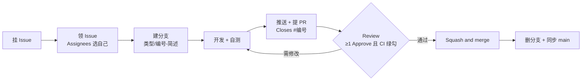

# 贡献流程（CONTRIBUTING）

> **组织级通用规范**（跨组接口变更、硬件版本与兼容性表、大文件策略、行为准则）见
> [`.github` 仓库](https://github.com/Kite-Robotics-Special-Interest-Group/.github/blob/main/CONTRIBUTING.md)；
> 本文件是 **Kite（模型与推理方向）** 的项目细则，冲突时以本文件为准。

适用对象：全部协作成员。**Git 命令基础**见 [docs/git-guide.md](docs/git-guide.md)；本文件是**流程标准**，规定「一个改动从提出到合并」的每一步。

> **重要前提**：本仓库是**免费版私有仓库**，GitHub 不提供分支保护（Rulesets）→ 平台不会拦住任何直推 `main` 的行为。
> 因此下面所有纪律**只能靠人执行**，请严格遵守，并在 Review 时互相提醒。

## 0. 流程总览



## 1. 前置准备（每人一次）

1. 收到邀请并接受（见 [docs/git-guide.md](docs/git-guide.md) 第 1.2 节）
2. 配置身份、安装 Git LFS、克隆仓库
3. 跑通环境：`python scripts/check_env.py`、`python -m pytest -q`（见 [docs/setup.md](docs/setup.md)）

## 2. 挂 Issue（提出问题的人做）

入口：仓库页 → **Issues → New issue** → 选模板（「任务」或「缺陷」）。

- **标题**：`[模块] 动词 + 对象`，例：`[runtime] 支持 ONNX 固定形状检查`
- **正文**：按模板填写——目标、验收标准、任务清单、影响范围、依赖/风险
- **标签**（右侧 Labels）：

  | 类别 | 取值 |
  | --- | --- |
  | 类型 | `type: feat` / `type: fix` / `type: docs` / `type: chore` |
  | 优先级 | `P0`（阻塞演示/线上）、`P1`（本迭代必做）、`P2`（有余力再做） |
  | 模块 | `module: model` / `module: runtime` / `module: data` / `module: docs` / `module: ci` |

- **指派**：明确谁做就直接选 Assignee；不确定就留空等别人领
- 一个 Issue = 一件事；如果发现要做的事超过 3 个文件、跨 2 个模块，拆成两个 Issue

## 3. 领 Issue（要做的人做）

1. Issue 页面右侧 **Assignees → 选自己**（或在 Issue 里评论 `/assign`）
2. 评论一句：`我来做，预计 X 天`（登记 + 让别人避让）
3. 有 `status: in-progress` 标签时打上（没有就跳过）
4. 确认「验收标准」与提问者一致，不清楚就在 Issue 里问清楚再动手

> 不要两个人同时做同一个 Issue；如果发现有人在做，去帮忙 Review 而不是并行重做。

## 4. 开分支

```bash
git checkout main
git pull origin main                 # 必须基于最新 main
git checkout -b feat/12-softprompt-fuse
```

命名规则：`类型/issue号-简述`（没有 Issue 号时用 `fix/hotfix-*`，见第 9 节）

| 前缀 | 用途 | 示例 |
| --- | --- | --- |
| `feat/` | 新功能 | `feat/12-softprompt-fuse` |
| `fix/` | 修 bug | `fix/31-onnx-dynamic-shape` |
| `docs/` | 文档 | `docs/24-contributing` |
| `chore/` | 配置/依赖/CI | `chore/22-add-ci` |
| `experiment/` | 实验（不一定合并） | `experiment/int4-g64` |

> 免费版没有规则约束，分支名是唯一的追踪线索：**必须带 Issue 号或写清关联 Issue**，否则 Review 时无法判断范围。

## 5. 开发与提交

- Commit 规范：`类型: 描述`（`feat:` / `fix:` / `docs:` / `refactor:` / `test:` / `chore:`）
- 小步提交：一次提交只做一件事，便于回退与 Review
- 提交前自查：

  ```bash
  git status                          # 确认没有多余文件（尤其 weights/、data/）
  python -m pytest -q                 # 测试必须通过
  python scripts/check_env.py         # 改依赖时跑
  python scripts/check_runtime.py     # 改运行时/配置时跑
  ```

- 与远程同步（有冲突见 [docs/git-guide.md](docs/git-guide.md) 第 5 节）：

  ```bash
  git pull --rebase origin main
  ```

- 禁止提交大文件：权重/数据集走网盘（`weights/README.md`）；确需入库的小二进制走 Git LFS

## 6. 推送与提 PR

```bash
git push -u origin feat/12-softprompt-fuse
```

然后在 GitHub 上：仓库页会出现 **Compare & pull request**（或 Pull requests → New pull request），
设置 `base: main` ← `compare: 你的分支`。

- **PR 标题**：与 commit 同规范，例：`feat: soft prompt 融合工具与方案文档`
- **PR 正文**：按仓库自带的 [PR 模板](.github/pull_request_template.md) 填写，
  必须包含 `Closes #12`（合并时自动关闭对应 Issue）
- **请求 Review**：右侧 Reviewers 至少选 1 人（**不能选自己**，GitHub 也不允许自我批准）；
  小改动同样要人看，不要「自己合自己的」
- **CI**：PR 页面底部会出现 Actions 结果，**绿勾才能合并**（配置见 `.github/workflows/ci.yml`）
- 先别急着求 Review：自测通过、变更范围清楚时，把 PR 状态设为 **Ready for review**

### Review 循环

1. 评审人在 Files changed 里留评论/请求修改
2. 你在**同一分支**继续提交并 `git push`，PR 自动更新
3. 重新请求 Review（Reviewers → 循环图标）
4. 有分歧就在 PR 里讨论，结论写进 PR 描述或 `docs/`，不要只留在线下聊天

## 7. 合并与收尾

合并前置（三条缺一不可）：

- [ ] CI 绿勾
- [ ] 至少 1 个 Approve
- [ ] 自己核对 Issue 的「验收标准」全部满足

合并方式选 **Squash and merge**：把分支上的多个提交压成一条，`main` 保持「一个提交一件事」。
合并提交信息保留规范前缀，例：`feat: soft prompt 融合工具与方案文档 (#12)`。

合并后收尾（**合并者负责**）：

```bash
git checkout main
git pull origin main
git branch -d feat/12-softprompt-fuse          # 删本地分支
git push origin --delete feat/12-softprompt-fuse   # 删远程分支（或点页面 Delete branch 按钮）
```

> **不要**手动去关 Issue：`Closes #12` 会在合并时自动关闭；如果没关，说明 PR 描述里漏写了。

## 8. 免费版纪律（没有分支保护，手动执行）

| 纪律 | 具体要求 |
| --- | --- |
| `main` 只接受 PR 合并 | 任何人（含管理员）都不得 `git push origin main` 直接提交 |
| PR 必须有人 Review | 至少 1 人 Approve；不允许自我批准 |
| CI 绿勾才合并 | Actions 失败先修；免费私有仓库每月 2000 分钟，本项目单次 CI < 1 分钟 |
| 合并后同步群内 | 在群里发「已合并 #12 ⟨标题⟩」，避免别人重复开工 |
| 每周抽查 | `git log --format='%h %an %s' origin/main -20`，看是否有绕过 PR 的直推 |
| 违约处理 | 第一次提醒 + 补 PR 说明；重复发生则回退该提交，走正常流程重做 |

> 如果将来升级到 GitHub Pro/Team，可在 **Settings → Rulesets** 打开
> “Require a pull request before merging”，把这些约定交给平台强制（届时本文第 8 节可以精简）。

## 9. 紧急修复（hotfix）

仅用于 P0：线上/演示被阻塞，且修一行就能恢复。

1. 分支名 `fix/hotfix-<现象>`，**可以不先挂 Issue**
2. PR 描述里必须写：影响面、验证方式、为什么不能等
3. 仍然要有 1 人 Approve（实在无人时，管理员合并并在群里公示原因）
4. 合并后补一个 Issue 记录本次故障与后续改进，并关联该 PR

## 10. 完成定义（DoD）

一个 PR 满足以下全部条件才算完成：

- [ ] 功能/修复可用，本地跑通
- [ ] `tests/` 有对应测试且 `python -m pytest -q` 通过
- [ ] `CHANGELOG.md` 的 `[Unreleased]` 加了条目
- [ ] 未提交大文件与密钥（`git status` 自查）
- [ ] PR 描述完整、含 `Closes #<issue>`

## 11. 术语速查

| 术语 | 含义 |
| --- | --- |
| Issue | 任务/缺陷的记录条目，有编号（如 #12） |
| Assignee | 被指派/领取的人；领 Issue 就选自己 |
| PR（Pull Request） | 「把我的分支合并进 main」的申请，含 diff 与讨论 |
| Review / Approve | 他人审阅；Approve 才算通过 |
| Squash and merge | 合并方式：把分支提交压成一条 |
| Draft PR | 草稿 PR，表示「还没做完，别急着 Review」 |
| Milestone | 一组 Issue/PR 的迭代分组（如「v0.2 板端跑通」） |

## 12. 命令速查

```bash
# 开分支
git checkout main && git pull origin main
git checkout -b feat/12-简述

# 提交
git status
python -m pytest -q
git add <文件>
git commit -m "feat: 描述（#12）"

# 推送与 PR
git push -u origin feat/12-简述
# 浏览器：Compare & pull request → base=main，选 Reviewer，写 Closes #12

# 合并后清理
git checkout main && git pull origin main
git branch -d feat/12-简述
git push origin --delete feat/12-简述
```
