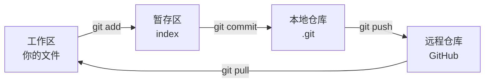

# Git / GitHub 使用教程（新手版）

本仓库是多人协作的**私有（private）仓库**，远程地址：`https://github.com/Kite-Robotics-Special-Interest-Group/Kite-Open.git`（管理员：muzirin）。

> **私有仓库意味着**：
> - 仓库内容只有被邀请的成员能看到，未被邀请的人（包括搜索引擎）访问会 404
> - 每个成员必须**先被管理员邀请并接受邀请**，才能 clone / push
> - 别把仓库地址随便发到公开群里，收到邀请的人也要保密

本文从零讲起，照着做即可参与协作。

## 1. 一次性配置与加入仓库（每台电脑 / 每人只做一次）

### 1.1 配置 Git 身份

```bash
git config --global user.name  "你的名字"
git config --global user.email "你的GitHub邮箱"
```

> 邮箱必须和 GitHub 账号一致：GitHub 头像 → Settings → Emails 查看。
> 若提交记录里作者显示不对，用 `git log --format=fuller` 查看，可删掉 `.git` 重来或 `git commit --amend --reset-author` 修正。

### 1.2 加入本私有仓库（第 1 步永远由管理员做）

**管理员（muzirin）操作一次：**

1. 打开 https://github.com/Kite-Robotics-Special-Interest-Group/Kite-Open/settings/access
2. **Collaborators → Add people**，输入对方的 GitHub 用户名或邮箱
3. 对方会在 GitHub 通知 / 邮件里收到邀请

**每个成员操作一次：**

1. 注册 GitHub 账号，把用户名告诉 muzirin
2. 打开 https://github.com/Kite-Robotics-Special-Interest-Group/Kite-Open/invitations 点 **Accept invitation**
   （或 GitHub 顶部铃铛通知 → 邀请 → Accept）
3. 验证：浏览器打开仓库地址能看见内容，而不是 404

> 免费账号的私有仓库可以加无限协作者，不用付费。
> 未受邀就 clone 会报 `Authentication failed` 或 `repository not found`——**多半不是你配错了，是还没被邀请**。

### 1.3 首次 clone 的登录认证

私有仓库 clone / push 时必须证明身份，**密码已不能直接用**：

- **方式 A（推荐）**：装 Git for Windows 自带的 Git Credential Manager，首次操作会弹浏览器登录 GitHub，一次登录长期保存（存在 Windows 凭据管理器里）
- **方式 B**：GitHub → Settings → Developer settings → Personal access tokens 生成 PAT，clone 时用户名填 GitHub 用户名、密码粘贴 PAT

```bash
git lfs install
git clone https://github.com/Kite-Robotics-Special-Interest-Group/Kite-Open.git
```

## 2. 核心概念（一张图）



- **commit**：一次本地存档，只存在于你自己电脑
- **push**：把本地存档上传到 GitHub，别人才看得到
- **pull**：把别人的最新提交下载下来
- **branch（分支）**：平行的开发线，功能做完合并回 `main`
- **Pull Request（PR）**：在 GitHub 上申请把你的分支合并进 `main`，供互相 Review

## 3. 日常五步（背下来）

```bash
git status                      # 1. 看当前改了什么（随时可用）
git add .                       # 2. 把改动放进暂存区
git commit -m "feat: 简短描述"   # 3. 本地存档
git pull origin main            # 4. 同步远程最新（在 main 分支上）
git push origin main            # 5. 上传（在 main 分支上）
```

查看历史与差异：

```bash
git log --oneline -10           # 最近 10 条提交
git diff                        # 未 add 的改动内容
```

## 4. 团队协作标准流程（重点）

> 流程标准（怎么挂/领 Issue、Review 与合并纪律、免费版无分支保护的约定）见仓库根目录
> [CONTRIBUTING.md](../CONTRIBUTING.md)；本节只讲对应的 Git 命令。

**原则：不直接在 `main` 上开发，一切改动走「功能分支 → PR → 合并」。**

```bash
# ① 先同步最新的 main
git checkout main
git pull origin main

# ② 创建并切换到自己的功能分支（名字用英文小写+短横线）
git checkout -b feature/add-data-loader

# ③ 改代码 → 提交
git add .
git commit -m "feat: 添加数据加载器"

# ④ 推送分支到 GitHub（-u 只需第一次，之后直接 git push）
git push -u origin feature/add-data-loader

# ⑤ 打开 GitHub 仓库页 → 点击 "Compare & pull request" → 创建 PR
#    等队友 Review 通过后，在 PR 页面点 "Merge pull request" 合并
```

合并后回到本地清理：

```bash
git checkout main
git pull origin main
git branch -d feature/add-data-loader     # 删除已合并的本地分支
git push origin --delete feature/add-data-loader  # 删除远程分支（可选）
```

### 分支命名约定

命名格式 `类型/issue号-简述`（issue 号可省略，但必须在 PR 里写 `Closes #号`）：

| 前缀 | 用途 | 示例 |
| --- | --- | --- |
| `feat/` | 新功能 | `feat/12-softprompt-fuse` |
| `fix/` | 修 bug | `fix/31-onnx-dynamic-shape` |
| `docs/` | 文档 | `docs/24-contributing` |
| `chore/` | 配置 / 依赖 / CI | `chore/22-add-ci` |
| `experiment/` | 实验（不一定合并） | `experiment/int4-g64` |

### Commit message 约定

格式：`类型: 一句话描述`（英文或中文均可，全组统一简洁）

| 类型 | 用途 |
| --- | --- |
| `feat:` | 新功能 |
| `fix:` | 修 bug |
| `docs:` | 文档 |
| `refactor:` | 重构（不改功能） |
| `test:` | 测试 |
| `chore:` | 杂项（配置、依赖） |

## 5. 冲突与异常处理

### 5.1 `rejected...fetch first`（远程有你没有的提交）

```bash
git pull --rebase origin main   # 把你的提交垫到别人提交之后
git push origin main
```

### 5.2 Rebase 中出现冲突（CONFLICT）

1. 打开提示冲突的文件，找到 `<<<<<<<` / `=======` / `>>>>>>>` 标记
2. 手动改成正确内容，删掉这三行标记
3. `git add 文件名`
4. `git rebase --continue`（放弃则 `git rebase --abort`）

> 每次开工先 `git pull`，冲突会少很多。

### 5.3 改乱了想回退

```bash
git restore 文件名          # 丢弃某文件未提交的修改
git restore --staged 文件名 # 取消 add，回到未暂存状态
```

### 5.4 误提交到 main / 提交错了分支

新手建议：`git reset --soft HEAD~1` 撤销最近一次提交（改动回到暂存区），再切到正确分支重新提交。

## 6. 常见报错速查

| 报错 | 原因与解决 |
| --- | --- |
| `src refspec main does not match any` | 还没有任何提交（分支上是空的）。先 `git add` + `git commit` |
| `fatal: Please tell me who you are` | 没配身份，见第 1 节 |
| `Failed to connect to github.com port 443` | 网络不通，配置代理：`git config --global http.https://github.com.proxy http://127.0.0.1:7897`（端口按本机代理软件改） |
| `schannel: failed to receive handshake` | 代理没正常转发（代理未启动/规则不通）：`git config --global --unset http.https://github.com.proxy` 后直连重试 |
| `! [rejected] main -> main (fetch first)` | 远程有新提交，先 `git pull --rebase origin main` |
| `Authentication failed` | 密码已弃用，用 Personal Access Token 或 Git Credential Manager 重新登录 |
| push 出现 `File too large` | 权重不该进 Git（网盘分发，见第 7 节）；确需入库的二进制用 Git LFS |
| pull 下来的 `.pt` 是几行文本 | 该文件走了 LFS 但你没装：装 LFS 后 `git lfs pull`，见第 7 节 |

## 7. 模型权重与大文件管理

**本项目策略：权重体积大、变化少 → 不进 Git，通过网盘分发；仓库只放代码与配置。**
权重清单、存放路径、网盘获取与校验步骤见 `weights/README.md`。

为什么这么定（客观限制）：

| 事实 | 影响 |
| --- | --- |
| GitHub Free 的 LFS 单文件上限 2 GB，fp32 权重 `model.safetensors` 有 3.36 GB | 根本推不上 GitHub |
| Free LFS 额度 10 GiB 存储 + 10 GiB/月下载流量，超出按量计费 | 权重一进仓库，队友几次克隆就耗光额度 |
| 权重很少变化 | 进 Git 没有版本化收益，只拖慢每次克隆 |

### 7.1 权重怎么拿到（每位成员一次）

1. 管理员在群里发网盘链接，下载 `model.safetensors`
2. 放到 `weights/X-VLA-WidowX/model.safetensors`
3. 按 `weights/README.md` 用 `SHA256SUMS.txt` 校验

`.gitignore` 已按扩展名忽略 `*.safetensors`、`*.pt`、`*.onnx`、`*.gguf` 等，**手滑也不会把权重提交上去**。

### 7.2 Git LFS（备用：小二进制要入库时）

普通 Git 单文件上限 100MB；**Git LFS** 把大文件本体存到专门服务器，仓库里只留几 KB 指针文件，
`add / commit / push` 用法不变。本仓库已在 `.gitattributes` 配好规则（`*.pt`、`*.onnx`、`*.safetensors` 等）。

```bash
git lfs install            # 一次性启用（Windows 装法见 docs/setup.md 第 0 节）
git lfs ls-files           # 查看仓库里哪些文件在 LFS
git lfs status             # 查看本次暂存的 LFS 对象
git check-attr filter 某文件   # 确认是否被 LFS 跟踪
```

> 权重扩展名目前同时被 `.gitignore` 忽略（第 7.1 节策略），所以日常不会进 LFS。
> 只有经团队同意、**小于 2 GB** 的二进制才入库：`git add -f 文件` 强制加入即可走 LFS。

### 7.3 LFS 额度与上限（用之前必读）

| 项目 | GitHub Free |
| --- | --- |
| 单文件上限 | 2 GB |
| 存储额度 | 10 GiB（超出按量计费，绑卡后超量扣费，未绑卡则停用 LFS） |
| 下载流量额度 | 10 GiB/月（队友每次克隆都会消耗） |

因此大权重永远走网盘；LFS 只留给小文件。详见 [GitHub 官方文档](https://docs.github.com/zh/repositories/working-with-files/managing-large-files/about-git-large-file-storage)。

## 8. GitHub 网页常用操作

- **Settings → Access（Collaborators）**：私有仓库的成员管理入口，只有管理员能邀请 / 移除协作者
- **Issues**：记录任务与 bug，开工前先领 Issue，做完在 PR 里写 `Closes #编号`
- **Pull Requests**：代码评审入口，至少一人 Approve 再合并
- **Actions**：CI 自动跑测试，PR 上绿勾才算通过
- **Settings → Branches**：给 `main` 加保护规则（禁止直接 push，必须走 PR）。若你的免费计划下该选项不可用，则以团队约定代替：任何人不直接改 `main`

### 管理员（muzirin）准备清单

仓库建好后，按顺序做一次即可：

1. **邀请成员**：Settings → Access → Collaborators → Add people（见 1.2），成员接受邀请
2. **保护 main**：Settings → Branches → Add branch protection rule（若可用）
   - Require a pull request before merging
   - Require status checks（接入 CI 后再勾）
3. **确认成员能拉取**：让每位成员 `git clone` + `python scripts/check_env.py` 跑通
4. **分配第一个任务**：在 Issues 里建任务，指派给成员，让其按第 4 节流程开分支开发

## 9. 建议的 Git 图形界面（可选）

命令入门前可用图形工具辅助理解：
- **Sourcetree**（免费）：Windows 上经典选择
- **VS Code 内置 Git**：左侧源代码管理面板，提交/分支/拉取全可视化
- **GitHub Desktop**：最简单

工具只是辅助，`git add / commit / pull / push / branch` 这几个命令必须会。
